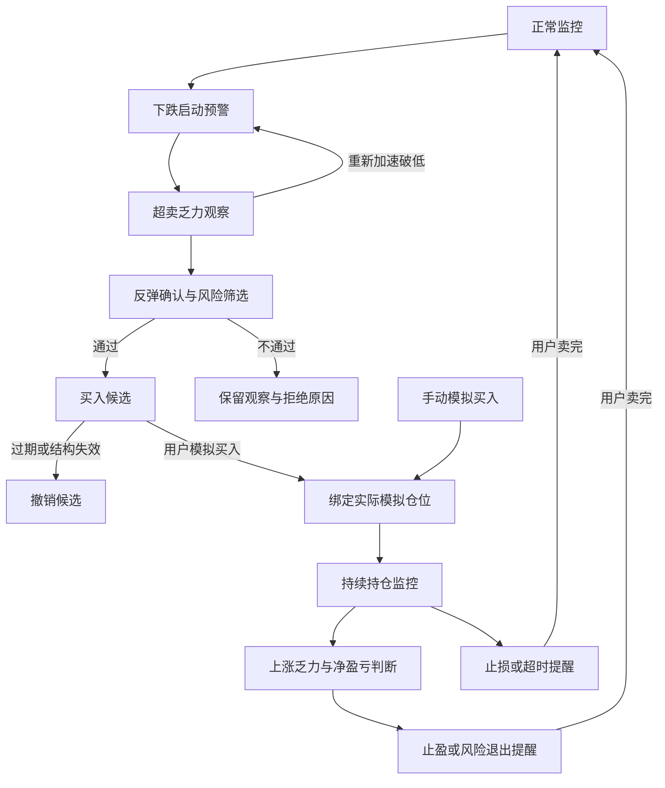

# Crypto-G 最终优化升级方案

## 真实行情驱动 · 四阶段预警 · 持仓退出联动

版本：方案 V1.0｜日期：2026-10-18（北京时间）

**文档性质：后续开发与验收的统一规格。功能方向已经明确，数值参数仍须研究验证；“最终方案”不表示新策略已经验证或上线。**

适用对象：BTCUSDT 现货做多。系统提供行情监测、买入候选、模拟持仓管理和退出提醒，不自动交易。

本方案整合此前固定参数提案、真实波动驱动需求、两轮研究结果，以及用户最后补充的四阶段预警思路。出现冲突时，以本方案的需求优先级为准；旧策略历史记录仍按原版本回放。

---

## 一、最终目标与已确定的取舍

系统从“跌到某个百分比才提醒”，升级为持续识别行情演进：

**下跌开始 → 超卖与卖压衰竭 → 反弹确认与买入筛选 → 买入后上涨衰竭与退出提醒。**

1. 尽早发现下跌启动，不要求先达到固定累计跌幅。
2. 超卖时只提醒观察；出现止跌与反转证据后，才考虑买入候选。
3. 买入候选必须满足结构目标、成本、净收益空间、止损、流动性和有效期要求。
4. 用户在模拟仓买入后，系统按实际记录的买入成本和剩余数量持续监控；上涨乏力时及时提示保护利润。
5. 趋势突破和普通区间低吸保留各自入口，不强制先经历大跌、超卖。
6. 波动分位数、ATR、RSI等作为证据，不将任何单一指标或分位数当作买卖指令。
7. 不追求最大推送量；同时衡量漏报、误报、提醒频率和扣费后交易结果。

### 需求变更结论

|此前设想|最终处理|
|---|---|
|固定跌幅作为唯一预警入口|取消；改为状态变化识别，跌幅大小保留为解释与辅助证据|
|直接采用1.80%、2.60%、0.65%、0.90%等新门槛|仅保留为研究对照，不能直接投入生产|
|直接采用P95等分位作为买入条件|不采用；本轮研究未找到正收益证据|
|S1-A/S1-B命名|大跌反弹归S1，极速反弹独立为S6|
|全部震荡逻辑塞入S2/S3|新增S7；S2保留既有支撑回踩基线，S3继续负责趋势回调|
|所有策略等待15分钟收盘|取消统一等待；按模块选择确认周期，并记录当时可见的数据|
|突破必须回踩|S4同时研究即时突破和回踩两条路径|
|达到固定止盈价才提醒退出|新增持仓上涨衰竭提醒；保留止损、结构失效与超时退出|
|全局统一止损与有效期|新版本改为模块风险配置；旧版本回放不变，新配置通过验证后才能启用|

## 二、已经完成的研究与结论边界

### 2.1 真实波动与收益空间研究

评估区间：北京时间2026-07-20 14:56至2026-10-18 14:56，右端不含。

- 90天共129,600根已收盘分钟K线，另有1,440根预热数据。
- 补齐1,481根；连续性、重复与OHLCV检查通过。
- 3,000根历史数据向公共接口抽查一致；这不是全量来源独立审计。
- 同时统计窗口起止跌幅与高点至收盘回撤，不能混为一种跌幅。
- 单列80,000–90,000 USDT价位子样本；不把该条件分布解释成价格高必然波动低。

|窗口|高点至收盘回撤P95|合并事件数|确认后30分钟净最大空间≥0.8%的比例|
|---|---:|---:|---:|
|5分钟|0.195%|1,680|2.50%|
|15分钟|0.343%|867|3.23%|
|1小时|0.696%|345|3.48%|
|4小时|1.466%|149|5.37%|

上述结果使用统一的简化确认代理、1分钟额外入场延迟、0.24%成本及5分钟静默去重。最后一列是后续最大价格空间比例，**不是胜率，也不是可兑现收益率**。不同窗口的事件不能相加。分钟收盘采样无法衡量全部秒级插针。

### 2.2 固定与动态门槛对照

使用260,640根分钟数据，包含91天预热与90天评估，6组门槛×3组成本×3组延迟，共54个场景。动态阈值只使用当时之前的数据。

主场景为来回成本0.24%、确认后额外延迟1分钟：

|门槛方案|模拟成交数|单笔平均净收益|
|---|---:|---:|
|文档固定门槛|14|−0.190%|
|训练期冻结P95|69|−0.148%|
|滚动P90|45|−0.167%|
|滚动P95|71|−0.272%|
|滚动P99|39|−0.260%|
|7/30天波动适配P95|55|−0.192%|

**没有方案通过预登记筛选。** 这说明在该共同确认、风险及退出模型下，仅改变门槛未形成正收益证据。

该研究不是原版S1–S4完整回测，也不是本方案四阶段系统的完整回测：使用了简化的单分钟确认、统一止损参考范围及整仓退出模型。不能据此断言四阶段方案必然无效，也不能挑选其中亏损最小的一组上线。

已查看过的历史不能重新命名为独立样本外；下一阶段需另行登记真正未见的验证区间。两轮研究工具共11项测试通过，重复运行汇总一致，不代表完整APP已完成新功能测试。

## 三、四阶段状态与用户体验

### 3.1 阶段一：下跌行情开始

目的：在下跌刚出现明显加速或结构恶化时提醒盯盘。

待验证证据包括：相对近期波动异常的负收益速度/加速度、卖方成交增强、短线支撑失守、连续下跌推进、量价变化。累计跌幅、ATR标准化幅度和历史分位作为背景，**不要求累计跌幅先达到固定值**。

通知：**【下跌行情预警】**。

展示价格、数据时间、观察窗口、实际跌幅、触发证据和“仅行情观察”。尚未形成交易计划时，入场、止损、目标显示“尚未形成”，不制造买点。

### 3.2 阶段二：超卖与下跌乏力

目的：提醒用户关注可能的筑底过程，不提前宣布底部成立。

需要“超卖状态”与“卖压衰竭证据”组合。候选证据包括：相对波动环境的价格偏离、RSI极端后改善、动能减弱、卖量增加但下跌推进减少、低点附近承接增强、拒跌形态。

通知：**【超卖乏力·关注企稳】**。

若重新加速破低，撤销企稳观察并更新为下跌状态。不能只因RSI低就进入此阶段；无真实盘口数据时不得展示“盘口承接已确认”。

### 3.3 阶段三：反弹确认与买入候选

目的：在当时可观察到的反转证据形成后，筛选仍具执行条件的机会。

候选确认方式：收复关键支撑、形成已确认的更高低点、突破已知的短线反弹高点，或真实微结构反转。具体组合与持续时间由预登记对照决定，不继续将“单根阳线突破上一分钟高点”当作已验证规则。

确认后依次检查：

1. 数据健康、报价新鲜、盘口及交易规模可支持成交。
2. 当前可买价仍处于模块有效入场范围。
3. 目标来自当时已经存在的结构，不根据利润要求人为抬高目标。
4. 结构止损合理，风险距离符合该模块已验证配置。
5. 扣除全部成本后，净目标与净盈亏比合格。
6. 有效期、组合风险与模块发布等级允许推送。
7. 投递前再次核验价格、成本和失效状态。

通知：**【反弹确认·买入候选】**，同时标明策略类型。明确列出入场区、止损、目标、预计净空间、风险距离、有效期及失效条件。

“确认”是当前证据成立，不宣称已找到未来路径的最低点。条件失效后撤销候选，不能留下仍可买入的旧弹窗状态。

### 3.4 阶段四：持仓超买与上涨乏力

目的：用户已买入后，提醒保护已有收益，减少盈利回吐。

触发前提是存在实际记录的模拟买入和剩余持仓，不能把“发送过买入信号”当作“用户已买入”。手动模拟买入也纳入监控。

按该仓位绑定的周期识别上涨延伸与衰竭：超买状态加上动能减弱、冲高回落、买方推进减少或承接转弱等证据。不能仅以RSI高宣布顶部。

- 若按当前可卖价估算、扣除适用费用和滑点后仍为净盈利：**【超买乏力·止盈提醒】**，提示保护利润；是否整仓或分批退出按验证通过的退出规则执行提示。
- 若未实现净盈利：**【上涨乏力·风险退出提醒】**，不能使用“获利了结”措辞。
- 不必先达到0.8%或1%才允许退出提醒。这些是买入筛选目标，不是阻止止损或保护利润的条件。
- 保留止损、结构失效、超时退出；不能等待超买才处理风险。
- 用户确认卖出后更新记录；系统不自动交易、不自动把提醒写成成交。

### 3.5 状态流转

允许证据充分时直接到达较高阶段，不强行补发已经过时的提醒。趋势和区间模块可从自己的确认入口进入买入候选，并共用持仓退出阶段。

## 四、策略模块与参数管理

|模块|业务职责|确认方向|买入净目标空间|持仓与有效期|
|---|---|---|---|---|
|S1 大跌企稳反弹|较大下跌后的反转|衰竭、支撑收复、更高低点等组合|严格>1.00%|不超过6小时；信号有效期独立验证|
|S3 趋势回调结束|多头趋势中回调完成|多周期趋势与回调恢复|≥0.80%|5分钟–6小时；按结构与确认周期配置|
|S4 趋势突破|全天候突破启动与突破后回踩|即时突破、回踩确认双分支|≥0.80%|即时分支采用较短有效期，回踩分支独立配置|
|S6 极速反弹|10秒–30分钟的快速回弹|真实成交、报价和盘口的微结构反转|首版买入研究按≥0.80%；较低目标不默认开放|最长30分钟；秒级/分钟级有效期，必须考虑人工响应|
|S7 区间低吸|真实箱体下沿企稳|ADX/ATR/布林带、箱体结构及拒跌证据|≥0.80%，目标在有效阻力之前|5分钟–6小时；有效破位立即失效|
|S2 既有支撑回踩|保留旧版比较基线|按原版本回放|旧版按旧规则；新用户路径是否纳入S7另行验证|不与S7重复推送同一机会|
|S5 时段动量研究|研究观察|不开放BUY推送|不适用|维持研究状态|

上述净目标指计划目标的扣费收益空间，不是整笔交易必得收益，也不是统计期望值。APP须分别展示目标净空间、当前净盈亏和整笔最终净收益。

### 4.1 独立风险配置

每个模块与分支配置：止损距离上下限、净目标下限、净盈亏比下限、入场范围、有效期、最大持仓时间、退出策略、数据质量要求和发布等级。禁止前端继续用旧全局1.20%上限覆盖新模块配置。

此前提过的S1止损0.40%–2.00%/极端2.50%、S6 0.20%–0.90%、区间0.35%–1.10%、S4 0.35%–1.50%，以及3/5/30分钟有效期，均列入**历史提案对照**，不是本方案已验证生产值。极端行情条件也应按新证据定义，不能偷偷沿用未经验证的固定跌幅。

结构止损先确定，之后再检查风险与仓位。超出允许风险时拒绝候选，不能缩窄结构止损来通过筛选。未完成风险配置验证的模块禁止输出正式交易级信号。

### 4.2 入场偏离与AI复核

S4即时突破与S6可研究动量容差，但不能直接恢复固定0.20%宽容：必须同时验证最新成交价下的净目标、止损、净盈亏比、流动性和有效期。允许范围登记在分支配置中，超出则撤销。若采用容差，应显示“动量追入·注意滑点”。

AI不生成交易价格、不替代确定性风险门禁。S1/S6不得仅以短周期均线空头否决反转。AI数据异常判断须有可核查证据；没有可靠清算数据源时不能声称已检查清算密集区。实时提醒不等待慢速AI；缺失关键行情数据仍由确定性门禁阻止买入候选。

## 五、交易成本、账户风险与持仓核算

### 5.1 成本口径

现有项目来回成本保守下限为0.24%，经证实适用BNB折扣时为0.19%。这些是项目模型下限，不代表已经查询用户账户的实际费率。实时估计高于下限时使用更高值。

参考价格模式：

> 净目标空间 = 目标参考涨幅 − 买入费用 − 卖出费用 − 价差及双边滑点。

可执行价格模式：买入按ask及规模冲击估价，卖出按bid及规模冲击估价；若价差/滑点已包含在价格中，不能再次扣除。保守成本下限不足部分作为显式风险准备，不篡改真实成交收益。

实际账本按实际买卖金额和手续费核算。以初始买入名义金额为分母：

> 整笔净收益率 =（累计卖出净收入 − 买入金额 − 买入费用）÷ 买入金额。

未卖出部分采用当前可卖价估值，并与已实现收益分列。加仓、部分卖出、费用币种换算及成交更正必须可追溯。若费用以BTC扣收，应使用净到账数量，避免重复计费。

按0.24%参考成本近似，净0.80%至少需要毛空间1.04%，净>1.00%需要毛空间>1.24%。实际以统一模型精算；不能为了凑空间扩大目标。

### 5.2 风险与退出

- 保留每笔0.5%权益风险预算、现货无杠杆；仓位按止损加成本计算，名义金额不超过可用资金。
- 同一BTC仓位、跨模块重复机会及组合风险必须统一管理，不允许各模块分别假定拥有全部账户资金。
- 保留原交易级熔断：连续两次止损或北京时间单日−2R时暂停交易级BUY四小时；观察提醒继续按原等级规则处理。
- 新版模块分别研究退出，不擅自改写旧版TP1卖50%、余仓跟踪等历史规则。
- 止损与结构失效优先于一般乏力提示；同一时刻不发相互矛盾的“继续持有”和“退出”。历史同柱不明顺序采用保守处理，并单独标注不确定性。
- 上涨乏力提醒必须绑定positionId、持仓版本与剩余数量；卖完终止。跨设备同步延迟时显示持仓状态待确认，避免对旧仓位重复提醒。

## 六、行情数据、事件与消息架构

### 6.1 数据层

保留现有分钟及多周期K线研究库；增加逐笔/聚合成交、最优报价及必要深度记录。记录交易所时间、接收时间、序列信息、断线、重连、缺口和报价年龄。

1分钟历史可用于分钟级阶段研究，但不能认证10秒反弹可执行。S6正式候选依赖真实微结构与延迟证据；不足时只输出明确的行情观察或数据不足状态。

所有高周期特征明确是已收盘结构还是盘中值。逐时点回放只能读取当时已知数据，禁止用最终K线结果充当盘中信号。标的价格超出8万–9万美元时仍正常按实际相对波动工作。

### 6.2 状态机与去重

新增持久化市场事件状态，记录：eventId、模块/分支、阶段、发生/确认时间、证据、规则版本、成本版本、失效原因和通知记录。

同一行情跨周期合并父事件；模块保留不同证据。投递幂等键包含设备、事件/仓位、阶段和有意义的状态版本，防止每次行情刷新都生成新提醒。重启后仍能恢复去重。

前两阶段与买入风控分流，不被净利润门槛静默拦截。用户可调整一般观察提醒的频率；持仓止损及关键风险提醒单独处理。冷却时间、恢复条件和升级规则需用事件频率与误报研究校准。

### 6.3 APP与通知详情

- 阶段一/二：当前价格、数据时间、跌幅/速度及衰竭证据；不强行显示买入计划。
- 阶段三：模块、确认依据、入场/止损/目标、净空间、有效期、失效条件、观察/交易等级。
- 阶段四：持仓成本、数量、当前可卖价、预计净盈亏、衰竭证据、退出提示和剩余仓位。
- 通知点击直接打开对应eventId或positionId详情；冷启动、后台恢复和锁屏点击均需覆盖。
- 消息进入持久化历史；阅读后进入历史，不因切页丢失。旧“每3小时清空全部消息”不能删除仍有效的计划、持仓事件和审计记录；保留期限作为独立设置。
- 测试消息始终明确标注测试，不写入正式买入信号或交易绩效。
- 分开记录服务端受理、推送平台接受、设备接收、展示与点击。平台接受不能显示成手机已经收到。

## 七、验证方法与通过条件

### 7.1 先定位问题，再增加规则

对现有研究逐笔分析：

1. 预警是否过迟，是否在行情已走完后触发。
2. 超卖阶段是否缺失，是否把持续下跌误认为卖压耗尽。
3. 确认是否太早/太迟，人工延迟后是否已无空间。
4. 结构目标是否现实，风险门禁拒绝了什么。
5. 是否出现曾盈利但未退出，最终转亏或利润回吐。

止损下限和上限分开诊断；不能把所有“止损距离拒绝”都称为1.20%上限误杀。针对被拒绝候选使用同样的可执行入场与退出模型回放，报告误放与误拒，不以未来最高价证明“本应买入”。

### 7.2 可比较的实验

- 先比较入口：现有固定、降低固定、动态统计、状态变化识别。
- 固定入口后比较确认：原简化确认、衰竭加确认、模块结构确认。
- 固定入场后比较退出：现有退出、结构目标退出、上涨乏力退出及经过登记的组合。
- 固定其余条件后比较模块风险边界与入场有效期。
- 最后比较完整原版S1–S4、新模块以及组合账户；单模块好看不代表组合账户有效。

所有变体在运行前登记，保留失败结果；不能同时修改很多规则后把改进归因于其中一项。研究参数与生产参数分开，禁止研究脚本自动写线上配置。

### 7.3 漏报和结果统计

先冻结独立的事件/机会标签协议，再计算：

- 行情识别漏报、首次提醒延迟、无效提醒与用户每天接收量。
- 满足预定义确认、执行及收益条件的机会覆盖率，区分未发现与发现后被门禁拒绝。
- 扣费后胜率、平均收益、净盈亏比、利润因子、日聚类置信区间、持有时间、账户盯市回撤。
- 盈利回吐、过早离场、止损后反弹、成本与人工延迟敏感性。
- 不同趋势/波动环境和价位区间的稳定性。

机会分母不使用新策略自己的触发集；未来路径可作事后标签，不能进入当时决策。0.8%/1%目标空间达标、整笔收益达标、统计期望值必须分开报告。

### 7.4 时间隔离与发布等级

每次校准仅使用过去数据，90天训练需有完整预热，7/30天状态不能包含未来。训练、验证和未见测试按时间划分，按最大6小时持有期处理跨边界标签与隔离。

不覆盖或改写既有D阶段协议；为新版登记独立协议与数据冻结点。历史已被查看的部分只能做开发诊断。数据不足则继续研究/观察，不补造胜率、PBO、DSR或盘口。

正式交易级沿用项目晋级要求：至少60笔未见样本交易，平均净收益≥0.10%且bootstrap 95%下界>0，胜率≥52%（上线目标55%）、利润因子≥1.30、PBO<0.30；试验超过20组时要求DSR>0.95，交易级频率0.5–6次/天，并满足既有波段覆盖要求。试验历史不完整时不能默认试验数为1。

上述交易级频率不限制行情观察级的研究统计。满足历史指标后仍须完成既有影子/试运行与回滚要求，不因某次回测通过就直接晋级。

## 八、开发改动范围

|层级|现有位置|新增或修改职责|
|---|---|---|
|研究数据|scratch/cryptog/kline_store.py、研究脚本|微结构采集、数据核验、事件与阶段标签、冻结实验|
|行情与调度|context_feed.py、runtime.py|盘中/收盘特征隔离，实时检测与状态恢复，延迟监测|
|策略引擎|engine_v2.py、config.py|保留v2基线；新增独立版本的模块、状态与风险配置，不在旧版本常量上覆盖|
|风险与成本|cost_model.py、cost_risk.py|按模块检查、报价规模成本、统一精算与不可变快照|
|AI复核|ai_review.py、review_bridge.py|反转模块否决边界、证据约束、超时与审计|
|持仓|stop_monitor.py、positions.py、execution_accounting.py|上涨衰竭分类、仓位版本、部分退出和净盈亏|
|推送|notifications.py、设备绑定与通知通道|状态升级/撤销、定向持仓提醒、幂等与投递证据|
|APP|signalValidity.ts、notificationService.ts、inbox.ts及消息/仓位面板|版本一致的有效性、详情定位、持仓关联、历史记录|
|模拟成交|quickPaper.ts、executionLedger.ts、positions.ts|用户成交确认、成本数量同步、剩余仓位与事件关联|

建议新研究规则使用独立版本标识，例如`wave-state-v3-research`；版本名称不代表自动替换`short-horizon-v2`。历史账本、通知与绩效必须携带原版本，不能混算。

## 九、实施阶段、交付物与验收

|阶段|状态/执行内容|交付物|进入下一阶段的条件|
|---|---|---|---|
|基础研究|已完成波动统计、门槛对照|两份报告、输入快照、逐事件与逐笔明细|明确负面结果及限制，不直接上线阈值|
|A 归因与标签|下一步执行；逐笔亏损、漏报与四阶段标签协议|归因报告、独立机会定义、冻结实验清单|分清入口、确认、目标、止损和退出的影响|
|B 模块研究与实现|S1/S3/S4/S7逐一重构；并行准备S6数据能力|独立模块、状态机、回放与参数证据|数据与成本可核查，不满足条件的模块保持研究|
|C 集成与自动化测试|后端、模拟仓、通知和APP联调|测试报告、消息留存及持仓链路|关键边界测试通过；旧版回放无非预期变化|
|D 未见验证与影子运行|按冻结规则积累证据，新旧分组记录|样本外、真实延迟及执行差异报告|满足相应发布等级；不足时不晋级|
|E 手机验收与灰度|三星S24+锁屏/后台/重启/点击详情/仓位更新|验收表、可回滚部署包、APK|确认实际送达与内容正确，范围可控|
|F 上线复核|配置版本、服务、数据和推送核验|上线验证与回滚记录|持续记录误报、漏报、成本偏离和性能退化|

S6秒级数据和真正未见样本需要实际采集时间，不承诺用已有分钟数据一次完成。其他模块可独立推进，不必等待S6才开展研究；上线范围按各模块证据分别决定。

### 必须覆盖的测试

- 在回放中修改未来行情，不改变过去的状态、阈值和信号。
- 数据断线、缺口、乱序、陈旧报价和重连恢复。
- 前两级不被利润门禁阻断，第三阶段不能绕过风险门禁。
- 状态跃迁、撤销、重复投递、服务重启和多设备去重。
- 短周期空头不会单独否决反转，缺失盘口不被伪装成承接确认。
- 实际入场偏离后重新计算净目标、止损及净盈亏比。
- 费用、价差及滑点不重复扣；部分卖出、加仓与费用币种处理正确。
- 未买入不发送该仓位止盈；卖完停止；盈利与未盈利文案正确。
- 未达目标也可发风险退出，止损不会被超买条件阻塞。
- 冷启动点击通知进入正确详情，历史不因切页或旧清理任务丢失。

## 十、部署、APK与回滚

本次交付是方案文件，不部署服务、不修改交易参数、不打包APK。

正式交付时应先完成具体变更、测试及回放，再准备数据库备份、配置版本快照和回滚脚本。研究级与交易级开关分离；有异常时关闭新模块，保留持仓风险提醒及必要数据记录。

APK遵循项目发布规则：`release/Crypto-G V{versionName}.apk`，每次发布versionName加0.01、versionCode加1。当前本地版本为1.57/157；若发布前没有其他版本，下一版为1.58/158，最终以构建时实际版本为准。

部署后核验：服务健康、行情新鲜度、版本匹配、旧仓位恢复、消息幂等、定向测试通知与详情。平台推送接受仅是链路中的一步，手机实际接收须单独验证。

## 十一、完成标准与待定项

### 完成标准

用户能提前看到下跌启动，识别超卖乏力阶段，在反弹确认且满足利润/风险条件后收到可追溯候选；模拟买入后能收到基于真实仓位成本的上涨乏力、止盈与风险退出提醒。整个过程不丢消息、不混淆观察与买入、不把目标收益称为保证盈利。

### 只能由后续证据确定的参数

下跌速度/加速度异常阈值、衰竭组合、超卖/超买的环境适配、确认持续时间、模块止损边界、有效期、动量容差、退出分批比例、状态恢复与冷却时间。

这些不是遗漏项，而是本方案明确要求通过预登记研究选择的项目。没有通过验证的数值，不能以“最终优化参数”的名义写入生产。

### 相关交付

- [第一项：真实波动与收益空间报告](../audit/btc-wave-study-20261018/报告.md)
- [第二项：固定与动态门槛对照报告](../audit/btc-dynamic-study-20261018/报告.md)
- [前期设计与四阶段补充](BTC真实波动驱动重构方案-2026-10-18.md)

**下一项具体工作：执行A阶段的亏损与漏报归因，并冻结四阶段标签和模块对照实验；暂不直接修改线上买卖规则。**
